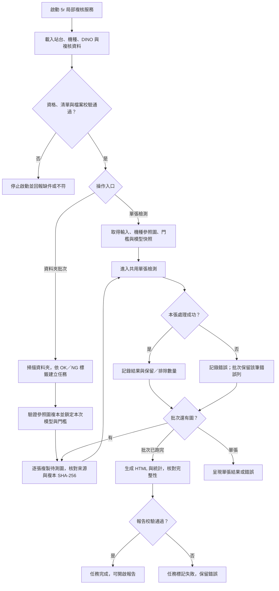
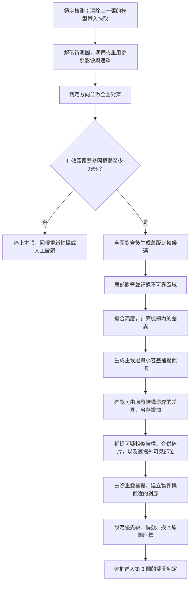
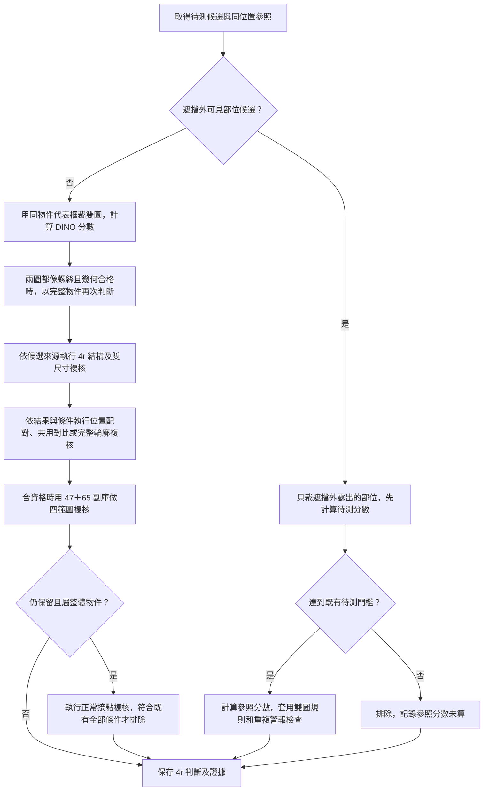
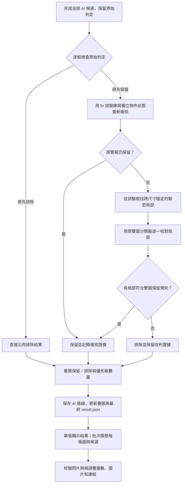

# X-RAY 5r.1 程式流程圖

[標準影像處理流程圖](FLOW_5R_1_IMAGE_PROCESSING.html)以影像輸入、處理和輸出為主，逐步說明目的。

程式基準為 Git 標籤 `5r.1`（`577e669`）。涵蓋隔離檢測服務啟動、單張處理、資料夾批次、候選生成、雙圖判定、5r 局部複核與結果輸出。圖中的「保留」代表列為警報供人工複核。OK／NG 資料夾標籤用於報告統計；分類器依參照圖、待測圖及既有規則判斷。

## 1. 啟動、收圖與批次管理

| 步驟 | 用意 |
|---|---|
| 啟動與校驗 | 隔離工作目錄。校驗局部複核包資格、指定程式及副庫雜湊，防止拿錯版本或資料。 |
| 固定機種與配置 | 讓同批照片使用一致的正常參照圖、候選門檻與模型快照。批次用鎖避免推論途中切換配置。 |
| 檔案複製與核對 | 固定這次要檢查的內容。原圖若在複製期間被改動，該張留錯誤紀錄。 |
| 批次逐張處理 | 每張寫入獨立目錄，回報進度。單張失敗時繼續處理其他圖。比對雜湊可另外標示參照圖自比。 |

## 2. 單張影像對齊與候選生成

| 步驟 | 用意 |
|---|---|
| 解碼、遮罩與全圖對齊 | 統一灰階值域，處理旋轉／鏡像與整體位置偏差。只用參照機體與有效取樣區的交集找候選。 |
| 生成比較候選 | 留下局部對齊前的比較資料，讓人工查閱對齊後消失或移動的候選。 |
| 局部對齊 | 修正局部偏移，避免既有邊緣因位置差而變成假警報。可靠度不足的局部區域留警示。 |
| 亮度擬合與殘差 | 先估計正常參照在此次拍攝下應有的亮度，再找待測圖新增的暗區。主候選用 3 像素容差，另用 1 像素容差補找貼著既有結構的小物件。 |
| 結構檢查與補提 | 找到可由參照結構解釋的差異時另列證據。合併可能屬於同一物件的碎片，並保留遮擋區外的可見部位供後續判斷。 |
| 物件對應與座標映射 | 候選框是搜尋位置，分類可選擇同一物件的代表框或完整輪廓。編號後把框與多邊形映回原圖，方便人工定位。 |

## 3. 4r 主判定與多級複核

| 步驟 | 用意 |
|---|---|
| DINO 單圖特徵 | 裁切後做影像尺寸與明暗正規化，由 ONNX 取整體及局部特徵。比較與螺絲／正常範例的相似度，依分數標記每張小圖。 |
| 雙圖判定 | **待測像螺絲且參照不像螺絲才保留。** 兩圖都像螺絲，或待測不像螺絲，這一輪判為排除。符合條件的候選仍可由後續複核改判。 |
| 可見部位 | 遮擋物本體不送入模型，只看外露局部。待測達門檻才計算參照，並檢查同物件是否已有警報。 |
| 4r 結構與雙尺寸 | 看兩種背景範圍，補回具有一貫螺絲證據的候選，並針對特定補提警報排除線材位移或板件邊界。僅可能由排除改為保留的路徑，任一必要條件失敗即可停止。 |
| 位置配對、共用對比、輪廓 | 高相似度位移配對用於追蹤參照既有物件。低對比參照在特定條件下共用待測的明暗尺度。小候選符合輪廓條件時，以完整輪廓及多種背景重看。 |
| 47＋65 四範圍 | 合資格的輪廓候選用四種背景重算。保留須待測平均支持螺絲且各參照視角都不支持。可直接放棄的路徑遇到任一參照否決條件即停止；整合輪廓分支仍保存完整分數。 |
| 正常接點 | 只可能移除原先保留的整體警報。長寬比要符合正常接點範例，四個待測視角都須較偏正常，兩類特徵的平均也要支持該正常接點。條件已不可能成立時保留原判定。 |

## 4. 5r 局部複核與輸出

| 步驟 | 用意 |
|---|---|
| 警報限定複核 | 先跑完原流程。只重新檢查原先保留的警報，隔離每一警報的物件狀態，避免影響其他框。 |
| 緊密局部保護 | 原警報若在試驗庫變成排除，另查長形候選內是否有穩定的小物件。任何局部通過原模型雙圖規則，即保留，並把分類代表框記為該局部。 |
| 輸出證據 | 保存 4r 基線、最終結果 JSON、原圖預覽、對齊雙圖、候選裁切、差異圖與警報疊圖，便於逐框追溯。 |
| 批次報告 | 首頁呈現 OK／NG 與完整照片結果，接續機種、誤報類型、相近位置及個別候選。零候選、自比、失敗照片都有紀錄。候選分類無人工標籤時顯示待確認。 |

## 5. 5r.1 加速點與程式入口

| 加速點 | 省下的工作 |
|---|---|
| 單張 ONNX 快取 | 同一模型與完全相同的輸入張量重用推論輸出；每張圖開始前清空。 |
| 對齊、亮度與候選重用 | 重用對齊遮罩、相關性、亮度擬合、8 位元雙圖、候選結構結果及同框輪廓。 |
| 用既有條件提早結束 | 可見部位待測不達標時省參照；補提的幾何或雙尺寸必要條件失敗時省後續裁切與推論；四範圍參照否決及正常接點條件也可提早結束。應保存完整分數的分支仍算完。 |

- 啟動與共用檢測入口見 [live5r_local_service.py](../experiments/dino/live5r_local_service.py)、[live5r_service.py](../experiments/dino/live5r_service.py)、[live4r_service.py](../experiments/dino/live4r_service.py)。
- 影像對齊、候選與證據輸出見 [detector.py](../detector.py)、[detection_runtime.py](../detection_runtime.py)、[new_model_run.py](../experiments/dino/new_model_run.py)。
- 雙圖及多級複核見 [dino_adapter.py](../dino_adapter.py)、[dino_paired_optimized.py](../dino_paired_optimized.py)、[improvement_policy.py](../experiments/dino/improvement_policy.py)、[visible_screw_policy_v3.py](../experiments/dino/visible_screw_policy_v3.py)、[correspondence_policy.py](../experiments/dino/correspondence_policy.py)、[example_audit_policy.py](../experiments/dino/example_audit_policy.py)、[integrated_bank_policy.py](../experiments/dino/integrated_bank_policy.py)、[connector_policy.py](../experiments/dino/connector_policy.py)。
- 警報回查及批次報告見 [live5r_review.py](../experiments/dino/live5r_review.py)、[alarm_review5r.py](../experiments/dino/alarm_review5r.py)、[local_object5r.py](../experiments/dino/local_object5r.py)、[folder_batch5r.py](../folder_batch5r.py)。
